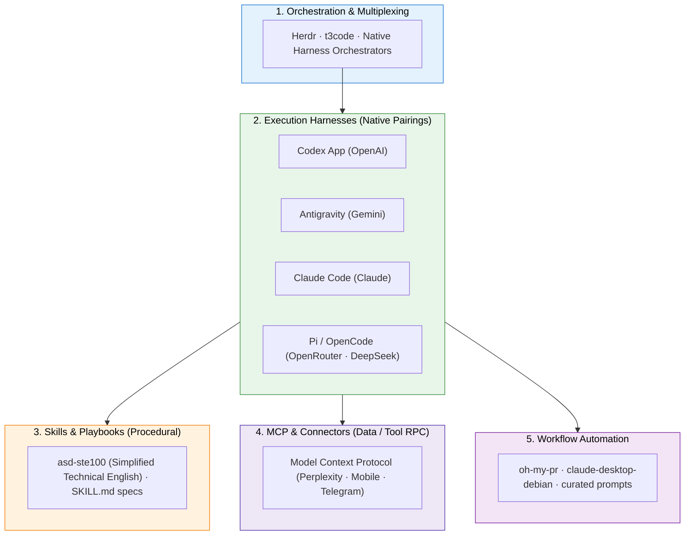

+++
title = "GenAI Agents Environment"
weight = 1
description = "A practical guide to the modern GenAI agent environment: orchestrators, native harnesses, skills, MCP servers, and workflow automation."
+++

*Last updated: November 2026*

The GenAI development ecosystem has matured from basic "autocomplete in an IDE" into a **modular agent operations stack**. Modern agentic engineering separates the system into distinct layers: orchestrators & multiplexers, execution harnesses, procedural skills, protocol connectors, and workflow automation.



---

## 🎛️ 1. Agent Orchestrators & Multiplexers

As workflows shift from single-turn prompts to running multiple agents across branches and tasks, orchestrators manage concurrent agent sessions, terminal state persistence, and handoffs.

| Tool | Core Philosophy | Best For | Link |
|------|-----------------|----------|------|
| **Herdr** | Open-source, agent-native terminal runtime and multiplexer | Persistent agent sessions, live status tracking (`Working`, `Blocked`, `Done`), and programmatic agent steering via `hc` | [herdr.dev](https://herdr.dev/) · [GitHub](https://github.com/herdr/herdr) |
| **t3code** | High-speed terminal and web UI orchestrator for multi-task coding | Parallel agent sessions and fast code review | [pingdotgg/t3code](https://github.com/pingdotgg/t3code) |
| **Native Harnesses** | Self-contained multi-agent environments (Codex App, Antigravity) | Full-workspace tasks, background subagents, and rich artifacts without external tooling | Integrated in native apps |

> **My Setup:** I use **Herdr** as my primary orchestrator for managing persistent agent sessions and tracking when an agent is blocked or done. For end-to-end features, I rely on the native orchestration loops built directly into **Codex App** and **Antigravity**.

---

## ⚡ 2. Agent Harnesses (Execution Engines)

The harness is the runtime engine that manages prompt assembly, tool execution loops, git diffing, and token streaming. 

### The Rule of Native Harnesses
> **Key Insight:** *Always prefer pairing a native harness with its corresponding foundation model.*
> 
> Generalist wrappers often introduce leaky abstractions, mismatched prompt formatting, and degraded tool calling. A native harness is specifically fine-tuned for the model's tokenizer, system prompt hierarchy, and tool-invocation syntax.

| Harness | Tier / Type | Primary Model Pairing | Strengths |
|---------|-------------|-----------------------|-----------|
| **Antigravity** | Google DeepMind Native | Gemini 2.5 / 3.0 Pro & Flash | Multi-agent collaboration, reactive background tasks, rich interactive artifacts, generous quotas |
| **Codex App** | OpenAI Native | OpenAI o-series / GPT-4.5 | Polished desktop harness, native worktree isolation, automations, and in-app tools |
| **Claude Code** | Anthropic Native | Claude 3.7 Sonnet (Hybrid CoT) | Ultra-fast CLI loop, deep git integration, subagent spawning |
| **Pi (`@mariozechner/pi-coding-agent`)** | Open-Source Minimalist CLI | DeepSeek V3 / R1 (via OpenRouter) or local weights | Minimalist, zero-slop hacker agent. Highly hackable, zero telemetry, fast startup |
| **OpenCode** | Open-Source CLI | OpenRouter / Ollama / DeepSeek | Full ownership, BYO keys, multi-model flexibility |
| **HermesAgent / OpenClaw** | Open-Source Autonomous Agents | Function-calling open weights | Specialized function calling and local inference workflows |

#### My Current Daily Setup:
* **Workstation Heavyweights:** **Codex App** (OpenAI) and **Antigravity** (Google) for production cloud architecture and complex multi-file engineering.
* **Local / Hacker Daily Driver:** **Pi** paired with **OpenRouter** targeting **DeepSeek** or free frontier models for fast command-line execution and cost-effective iteration.

---

## 🧩 3. Agent Skills vs. MCP: Understanding the Boundary

Developers frequently confuse **Skills** and **MCP (Model Context Protocol)**. They solve two fundamentally different problems:

* **Skills (Procedural Knowledge):** *How the agent thinks and acts.* Standardized markdown instructions, conventions, and reusable scripts loaded on-demand without bloating system prompts.
* **MCP (State & Connectivity):** *What external tools and data the agent accesses.* Client-server RPC protocol connecting agents to APIs, databases, and device interfaces.

```
┌────────────────────────────────────────────────────────┐
│                        AGENT                           │
│  ┌─────────────────────────┐  ┌─────────────────────┐  │
│  │   SKILLS (Procedural)   │  │   MCP (Connectors)  │  │
│  │ • How to format docs    │  │ • Query Perplexity  │  │
│  │ • Rule checklists       │  │ • Control Mobile OS │  │
│  │ • Simplified English    │  │ • Send Telegram msg │  │
│  └─────────────────────────┘  └─────────────────────┘  │
└────────────────────────────────────────────────────────┘
```

### The Standard for Technical Writing: ASD-STE100

* **[asd-ste100-skill](https://github.com/danyuchn/asd-ste100-skill):** Enforces **Simplified Technical English (ASD-STE100)** for clean, unambiguous technical writing.
  * **Karpathy's Recommendation:** Andrej Karpathy highlighted Simplified Technical English as an ideal framework for prompting LLMs to write technical documentation. By restricting vocabulary to a single meaning per word and eliminating unnecessary filler, it forces the model to generate clear, deterministic, and fluff-free explanations.
* **[SKILL.md Spec](https://github.com/cyxzdev/Uncodixfy/blob/main/SKILL.md):** The declarative standard for packaging instructions, triggers, and bundled scripts so agents can load capabilities modularly on-demand.

---

## 🔌 4. Recommended MCP (Model Context Protocol) Servers

MCP eliminates vendor lock-in by providing a universal protocol for tool exposure. A single MCP configuration works across Antigravity, Claude Code, and headless agents.

| MCP Server | Protocol Capability | Link |
|------------|---------------------|------|
| **Perplexity MCP** | Real-time web research, fact verification, and grounded citations | [perplexityai/modelcontextprotocol](https://github.com/perplexityai/modelcontextprotocol) |
| **Mobile MCP** | Autonomous iOS/Android device automation and mobile testing | [mobile-next/mobile-mcp](https://github.com/mobile-next/mobile-mcp) |
| **Telegram MCP** | Interactive bot messaging, alert hooks, and remote approvals | [chigwell/telegram-mcp](https://github.com/chigwell/telegram-mcp) |

---

## 🛠️ 5. Workflow Automation & Utilities

Tools for automated reviews and desktop workflows:

* **oh-my-pr**: Automated PR generation, code review synthesis, and validation loops ([yungookim/oh-my-pr](https://github.com/yungookim/oh-my-pr)).
* **awesome-claude-prompts**: High-signal curated prompt engineering patterns ([yzfly/awesome-claude-prompts](https://github.com/yzfly/awesome-claude-prompts)).
* **claude-desktop-debian**: Packaging to run desktop agent environments natively on Debian/Ubuntu Linux ([aaddrick/claude-desktop-debian](https://github.com/aaddrick/claude-desktop-debian)).

---

## 📌 Summary: The 2026 Pragmatic Stack

If you want a productive, cost-effective setup today without getting trapped in fragile abstractions:

1. **Orchestration:** Use **Herdr** for persistent agent tracking across terminal panes, or lean on the native multi-agent loops in **Codex App** and **Antigravity**.
2. **Native Cloud Harnesses:** **Antigravity** (Gemini) and **Codex App** (OpenAI) for complex multi-file architectural work.
3. **Local / Hacker Terminal:** **Pi** with **OpenRouter** routing to **DeepSeek** for high-volume, low-cost CLI tasks.
4. **Skills over Fluff:** Use **`asd-ste100`** for deterministic, fluff-free documentation and modular `SKILL.md` playbooks.
5. **Connectors:** Plug in **MCP servers** (Perplexity, Mobile, Telegram) for universal tool integration across any harness.
