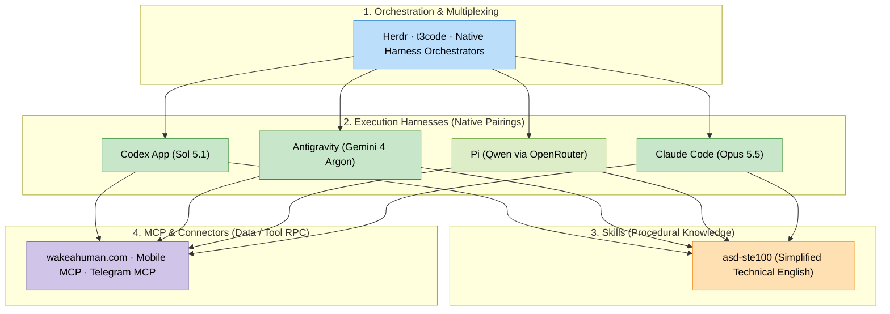
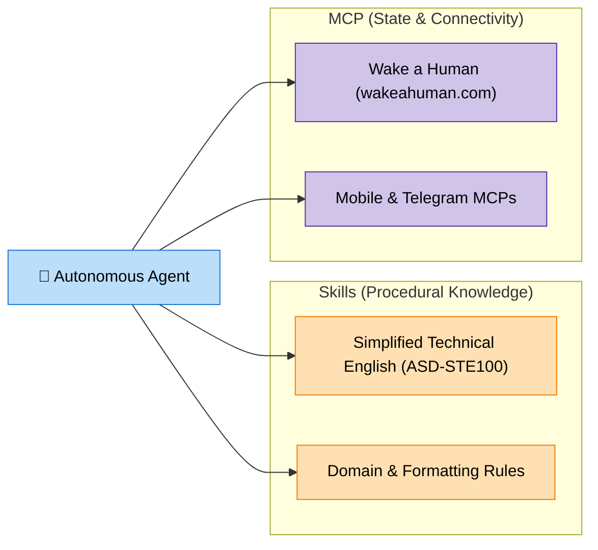

+++
title = "GenAI Agents Environment"
weight = 1
description = "A practical guide to the modern GenAI agent environment: orchestrators, native harnesses, skills, and MCP servers."
+++

*Last updated: November 2026*

The GenAI development ecosystem has matured from basic "autocomplete in an IDE" into a **modular agent operations stack**. Modern agentic engineering separates the system into four distinct layers: orchestrators & multiplexers, execution harnesses, procedural skills, and protocol connectors.

---

## 🎛️ 1. Agent Orchestrators & Multiplexers

As workflows shift from single-turn prompts to running multiple agents across branches and tasks, orchestrators manage concurrent agent sessions, terminal state persistence, and handoffs.

| Tool | Core Philosophy | Best For | Link |
|------|-----------------|----------|------|
| **Herdr** | Open-source, agent-native terminal runtime and multiplexer | Persistent agent sessions, live status tracking (`Working`, `Blocked`, `Done`), and programmatic agent steering via `hc` | [herdr.dev](https://herdr.dev/) · [GitHub](https://github.com/herdr/herdr) |
| **t3code** | High-speed terminal and web UI orchestrator for multi-task coding | Parallel agent sessions and fast code review | [pingdotgg/t3code](https://github.com/pingdotgg/t3code) |
| **Native Harnesses** | Self-contained multi-agent environments (Codex App, Antigravity) | Full-workspace tasks, background subagents, and rich artifacts without external tooling | Integrated in native apps |

> **My Setup:** I use **Herdr** as my orchestrator for managing persistent CLI agent sessions and tracking when an agent is blocked or done, alongside the native orchestration loops built directly into **Codex App** and **Antigravity**.

---

## ⚡ 2. Agent Harnesses (Execution Engines)

The harness is the runtime engine that manages prompt assembly, tool execution loops, git diffing, and token streaming. 

### The Rule of Native Harnesses
> **Key Insight:** *Always prefer pairing a native harness with its corresponding foundation model.*
> 
> Generalist wrappers often introduce leaky abstractions, mismatched prompt formatting, and degraded tool calling. A native harness is specifically fine-tuned for the model's tokenizer, system prompt hierarchy, and tool-invocation syntax.

| Harness | Tier / Type | Primary Model Pairing | Strengths |
|---------|-------------|-----------------------|-----------|
| **Codex App** | OpenAI Native | **Sol 5.1** | Polished desktop harness, native worktree isolation, automations, and in-app tools |
| **Antigravity** | Google DeepMind Native | **Gemini 4 Argon** | Multi-agent collaboration, reactive background tasks, rich interactive artifacts, generous quotas |
| **Pi (`@mariozechner/pi-coding-agent`)** | Open-Source Minimalist CLI | **Qwen** (via OpenRouter) | Minimalist, zero-slop hacker agent. Highly hackable, zero telemetry, fast startup |
| **Claude Code** | Anthropic Native | **Claude Opus 5.5** | Fast CLI loop, deep git integration, subagent spawning |

#### My Current Daily Setup:
* **Native Workstation Heavyweights:** **Codex App** (`Sol 5.1`) and **Antigravity** (`Gemini 4 Argon`) for production architecture and complex multi-file engineering.
* **Multiplexed CLI Driver:** **Herdr** orchestrating **Pi** connected to **OpenRouter** (running **Qwen** and free/low-cost models) for fast parallel command-line execution.

---

## 🧩 3. Agent Skills vs. MCP: Understanding the Boundary

Developers frequently confuse **Skills** and **MCP (Model Context Protocol)**. They solve two fundamentally different problems:

* **Skills (Procedural Knowledge):** *How the agent thinks and writes.* Domain rules, writing constraints, and workflow instructions loaded when needed without bloating the base prompt.
* **MCP (State & Connectivity):** *What external tools and services the agent calls.* Client-server RPC protocol connecting agents to external APIs, escalation chains, and device interfaces.

### The Standard for Technical Writing: ASD-STE100

* **[asd-ste100-skill](https://github.com/danyuchn/asd-ste100-skill):** Enforces **Simplified Technical English (ASD-STE100)** for clean, unambiguous technical writing.
  * **Karpathy's Recommendation:** Andrej Karpathy highlighted Simplified Technical English as an ideal framework for prompting LLMs to write technical documentation. By restricting vocabulary to a single meaning per word and eliminating unnecessary filler, it forces the model to generate clear, deterministic, and fluff-free explanations.

---

## 🔌 4. Recommended MCP (Model Context Protocol) Servers

MCP eliminates vendor lock-in by providing a universal protocol for tool exposure. A single MCP configuration works across Antigravity, Codex, Claude Code, and headless agents.

| MCP Server | Protocol Capability | Link |
|------------|---------------------|------|
| **Wake a Human** | Human-in-the-loop escalation & decision paging—pages you only on high-stakes choices (architecture, auth, prod, billing) while auto-resolving routine decisions based on threshold and timeout policies | [wakeahuman.com](https://wakeahuman.com) |
| **Mobile MCP** | Autonomous iOS/Android device automation and mobile testing | [mobile-next/mobile-mcp](https://github.com/mobile-next/mobile-mcp) |
| **Telegram MCP** | Interactive bot messaging, alert hooks, and remote notifications | [chigwell/telegram-mcp](https://github.com/chigwell/telegram-mcp) |

---

## 📌 Summary: The Pragmatic Stack

1. **Orchestration:** **Herdr** for persistent terminal agent multiplexing, paired with native multi-agent loops in **Codex App** and **Antigravity**.
2. **Native Cloud Harnesses:** **Codex App** (`Sol 5.1`) and **Antigravity** (`Gemini 4 Argon`).
3. **Local / CLI Driver:** **Pi** with **OpenRouter** running **Qwen**.
4. **Skills over Fluff:** **`asd-ste100`** (Karpathy's recommendation) for deterministic, fluff-free documentation.
5. **Human-in-the-Loop & Connectors:** **[wakeahuman.com](https://wakeahuman.com)** MCP for high-stakes decision escalation, alongside Mobile and Telegram MCPs.
