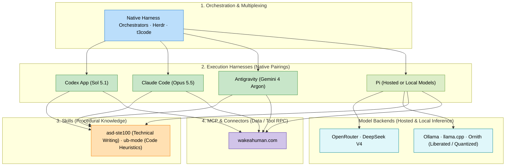
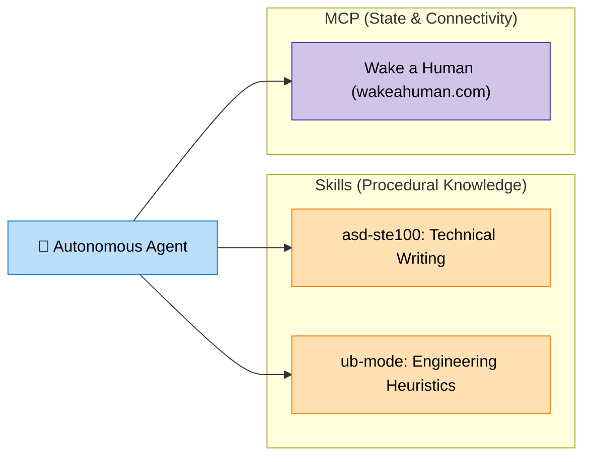

+++
title = "Agentic Stack"
weight = 1
description = "The layers of an agentic development stack: orchestrators, execution harnesses, skills, and MCP connectors."
+++

*Last updated: November 2026*

This page maps the tools and responsibilities in an agentic development stack. For my day-to-day configuration and workflow, see [Agentic Workspace](@/generative-ai/1-intro/2_agentic_workspace.md).

The GenAI development ecosystem has matured from basic "autocomplete in an IDE" into a **modular agent operations stack**. Modern agentic engineering separates the system into four distinct layers: orchestrators & multiplexers, execution harnesses, procedural skills, and protocol connectors.

---

## 🎛️ 1. Agent Orchestrators & Multiplexers

As workflows shift from single-turn prompts to running multiple agents across branches and tasks, orchestrators manage concurrent agent sessions, terminal state persistence, and handoffs.

| Tool | Core Philosophy | Best For | Link |
|------|-----------------|----------|------|
| **Native Harnesses** | Self-contained multi-agent environments (Codex App, Antigravity) | Full-workspace tasks, background subagents, and rich artifacts without external tooling | Integrated in native apps |
| **Herdr** | Open-source, agent-native terminal runtime and multiplexer | Persistent agent sessions, live status tracking (`Working`, `Blocked`, `Done`), and programmatic agent steering via `hc` | [herdr.dev](https://herdr.dev/) · [GitHub](https://github.com/herdr/herdr) |
| **t3code** | High-speed terminal and web UI orchestrator for multi-task coding | Parallel agent sessions and fast code review | [pingdotgg/t3code](https://github.com/pingdotgg/t3code) |

---

## ⚡ 2. Agent Harnesses (Execution Engines)

The harness is the runtime engine that manages prompt assembly, tool execution loops, git diffing, and token streaming. 

### Native Harnesses and Flexible Model Backends

Native harnesses provide an integrated workflow for their model families. Configurable harnesses such as Pi also give me a place to work with hosted or locally served models. The harness runs the agent loop; the model backend supplies inference.

| Harness | Tier / Type | Primary Model Pairing | Strengths |
|---------|-------------|-----------------------|-----------|
| **Codex App** | OpenAI Native | **Sol 5.1** | Polished desktop harness, native worktree isolation, automations, and in-app tools |
| **Claude Code** | Anthropic Native | **Claude Opus 5.5** | Fast CLI loop, deep git integration, subagent spawning |
| **Antigravity** | Google DeepMind Native | **Gemini 4 Argon** | Multi-agent collaboration, reactive background tasks, rich interactive artifacts, generous quotas |
| **Pi** | Open-Source Minimalist CLI | **Hosted or local models** | Minimalist, zero-slop hacker agent. Highly hackable, zero telemetry, fast startup |

### Hosted and Local Model Runtimes

I use **OpenRouter for DeepSeek V4**, and **Ollama** or **llama.cpp** to run models locally and reduce API spending. These sit alongside the execution harness: the agent manages the task and calls a model endpoint for inference.

| Backend | Role in the setup | Link |
|---------|-------------------|------|
| **OpenRouter** | Hosted model access; my current choice here is DeepSeek V4 | [OpenRouter](https://openrouter.ai/) |
| **Ollama** | Download and serve local models for compatible agents and applications | [Ollama documentation](https://docs.ollama.com/) |
| **llama.cpp** | Local inference with quantized models, CPU/GPU execution, and an OpenAI-compatible server | [llama.cpp](https://github.com/ggml-org/llama.cpp) |

For local work, I am currently using **Ornith**, usually with liberated, quantized model variants. Quantization reduces model memory requirements; the useful tradeoff is how much quality and responsiveness I retain on my hardware. Model size, context length, and tool-call reliability all matter when choosing a local model for agentic work.

My aim is to keep the workspace familiar while changing where inference runs. See [Agentic Workspace](@/generative-ai/1-intro/2_agentic_workspace.md) for how this fits into my daily setup.

---

## 🧩 3. Agent Skills vs. MCP: Understanding the Boundary

Developers frequently confuse **Skills** and **MCP (Model Context Protocol)**. They solve two fundamentally different problems:

* **Skills (Procedural Knowledge):** *How the agent thinks and writes.* Domain rules, writing constraints, and workflow instructions loaded when needed without bloating the base prompt.
* **MCP (State & Connectivity):** *What external tools and services the agent calls.* Client-server RPC protocol connecting agents to external APIs, escalation chains, and device interfaces.

### The Standard for Technical Writing: ASD-STE100

* **[asd-ste100-skill](https://github.com/danyuchn/asd-ste100-skill):** Enforces **Simplified Technical English (ASD-STE100)** for clean, unambiguous technical writing.
  * **Karpathy's Recommendation:** Andrej Karpathy highlighted Simplified Technical English as an ideal framework for prompting LLMs to write technical documentation. By restricting vocabulary to a single meaning per word and eliminating unnecessary filler, it forces the model to generate clear, deterministic, and fluff-free explanations.

### Code Heuristics: ub-mode

* **[ub-mode](https://github.com/unclebob/ub-mode):** Uncle Bob's skill for coding agents: reason from first principles, use TDD, fix root causes, and refactor. Companion tools check complexity, duplication, and test effectiveness.

---

## 🔌 4. Recommended MCP (Model Context Protocol) Servers

MCP eliminates vendor lock-in by providing a universal protocol for tool exposure. A single MCP configuration works across Antigravity, Codex, Claude Code, and headless agents.

| MCP Server | Protocol Capability | Link |
|------------|---------------------|------|
| **Wake a Human** | Human-in-the-loop escalation & decision paging—pages you only on high-stakes choices (architecture, auth, prod, billing) while auto-resolving routine decisions based on threshold and timeout policies | [wakeahuman.com](https://wakeahuman.com) |

---

## Putting the Layers Together

1. **Orchestration** manages sessions, concurrent work, and agent status.
2. **Execution harnesses** run the agent's tool and reasoning loop.
3. **Skills** supply reusable procedures and domain guidance.
4. **MCP connectors** expose external tools and data.

These layers provide a way to reason about a setup as its tools change. The next step is deciding how to work with them every day: [Agentic Workspace](@/generative-ai/1-intro/2_agentic_workspace.md).
