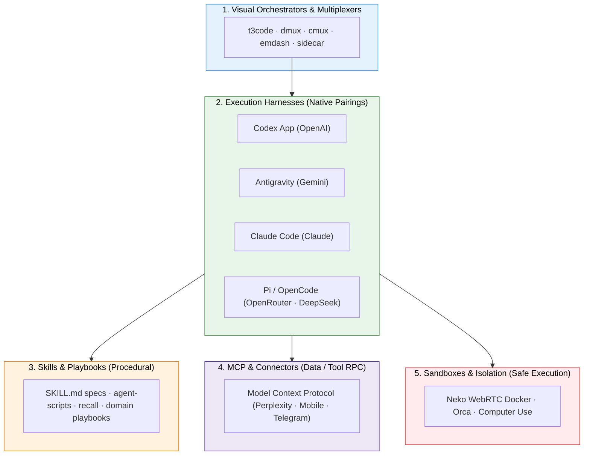

+++
title = "GenAI Agents Environment"
weight = 1
description = "A practical guide to the modern GenAI agent environment: visual orchestrators, native harnesses, skills, MCP servers, and sandboxes."
+++

*Last updated: November 2026*

The GenAI development ecosystem has shifted from basic "autocomplete in an IDE" to a **multi-tiered agent operations stack**. Modern agentic engineering separates the system into distinct layers: visual orchestrators, execution harnesses, modular skills, protocol connectors, and isolated sandboxes.



---

## 🎛️ 1. Agents Visual Orchestrators & Terminal Multiplexers

As workflows scale from single-turn chat to running multiple parallel agents across worktrees, traditional IDEs become the bottleneck. A new class of orchestrators, multiplexers, and dashboards has emerged to coordinate concurrent agent tasks.

| Tool | Core Philosophy | Best For | Link |
|------|-----------------|----------|------|
| **t3code** | High-speed terminal & web UI orchestrator for multi-task coding | Parallel agent sessions & fast review | [pingdotgg/t3code](https://github.com/pingdotgg/t3code) |
| **dmux** | Terminal multiplexer designed specifically for agent workflows | Headless agent swarming across worktrees | [dmux.ai](https://dmux.ai/) · [standardagents/dmux](https://github.com/standardagents/dmux) |
| **cmux** | Context-aware multiplexer for multi-agent terminal management | Splitting agent logs & interactive shells | [manaflow-ai/cmux](https://github.com/manaflow-ai/cmux) |
| **emdash** | Visual dashboard & execution workspace for autonomous coding | GUI-driven multi-agent tracking | [generalaction/emdash](https://github.com/generalaction/emdash) |
| **sidecar** | Lightweight companion agent panel next to your editor | Keeping persistent agent context close | [marcus/sidecar](https://github.com/marcus/sidecar) |
| **Agent Orchestrator** | Composio's multi-agent routing harness | Connecting complex agent workflows | [ComposioHQ/agent-orchestrator](https://github.com/ComposioHQ/agent-orchestrator) |

> **The Multi-Agent Parallel Pattern:** Popularized by builders like Pieter Levels ([levels.io](https://x.com/levelsio/status/2057933239600263582)), the winning workflow is no longer watching one agent slowly type code. Instead, developers multiplex several headless agent sessions simultaneously (each bound to its own git worktree branch) and use tools like **t3code** or **dmux** to manage handoffs, reviews, and merges.

---

## ⚡ 2. Agent Harnesses (Execution Engines)

The harness is the runtime engine that manages prompt assembly, tool execution loops, git diffing, and token streaming. 

### The Rule of Native Harnesses
> **Key Insight:** *Always prefer pairing a native harness with its corresponding foundation model.*
> 
> Generalist wrappers often introduce leaky abstractions, mismatched prompt formatting, and degraded tool calling. A native harness is specifically fine-tuned for the model's tokenizer, system prompt hierarchy, and tool-invocation syntax.

| Harness | Tier / Type | Primary Model Pairing | Strengths |
|---------|-------------|-----------------------|-----------|
| **Antigravity** | Google DeepMind Native | Gemini 2.5 / 3.0 Pro & Flash | Multi-agent collaboration, reactive background tasks, rich interactive artifacts, generous quotas |
| **Codex App** | OpenAI Native | OpenAI o-series / GPT-4.5 | Polished desktop harness, native worktree isolation, automations, and in-app tools |
| **Claude Code** | Anthropic Native | Claude 3.7 Sonnet (Hybrid CoT) | Ultra-fast CLI loop, deep git integration, subagent spawning |
| **Pi (`@mariozechner/pi-coding-agent`)** | Open-Source Minimalist CLI | DeepSeek V3 / R1 (via OpenRouter) or local weights | Minimalist, zero-slop hacker agent. Highly hackable, zero telemetry, fast startup |
| **OpenCode** | Open-Source CLI | OpenRouter / Ollama / DeepSeek | Full ownership, BYO keys, multi-model flexibility |
| **HermesAgent / OpenClaw** | Open-Source Autonomous Agents | Function-calling open weights | Specialized function calling and local inference workflows |

#### My Current Daily Setup:
* **Workstation Heavyweight:** **Codex App** (OpenAI) and **Antigravity** (Google) for production cloud architecture and complex multi-file engineering.
* **Local / Hacker Daily Driver:** **Pi** paired with **OpenRouter** targeting **DeepSeek** or free frontier models for fast command-line execution and cost-effective iteration.

---

## 🧩 3. Agent Skills vs. MCP: Understanding the Boundary

Developers frequently confuse **Skills** and **MCP (Model Context Protocol)**. They solve two fundamentally different problems:

* **Skills (Procedural Knowledge):** *How the agent thinks and acts.* Standardized markdown instructions, conventions, and reusable scripts loaded on-demand.
* **MCP (State & Connectivity):** *What external tools and data the agent accesses.* Client-server RPC protocol connecting agents to APIs, databases, and device interfaces.

```
┌────────────────────────────────────────────────────────┐
│                        AGENT                           │
│  ┌─────────────────────────┐  ┌─────────────────────┐  │
│  │   SKILLS (Procedural)   │  │   MCP (Connectors)  │  │
│  │ • How to format code    │  │ • Query Perplexity  │  │
│  │ • How to run migrations │  │ • Control Mobile OS │  │
│  │ • Domain checklists     │  │ • Send Telegram msg │  │
│  └─────────────────────────┘  └─────────────────────┘  │
└────────────────────────────────────────────────────────┘
```

### Essential Skills & Script Bundles

| Repository / Skill | Purpose | Link |
|--------------------|---------|------|
| **Uncodixfy / SKILL.md** | Clean, declarative standard for defining agent skill manifests and invocation triggers | [cyxzdev/Uncodixfy](https://github.com/cyxzdev/Uncodixfy/blob/main/SKILL.md) |
| **agent-scripts** | Battle-tested utility scripts and automation hooks for coding agents (by Peter Steinberger) | [steipete/agent-scripts](https://github.com/steipete/agent-scripts) |
| **recall** | Context retrieval and persistent memory tools across agent sessions | [arjunkmrm/recall](https://github.com/arjunkmrm/recall) |
| **asd-ste100-skill** | Enforces Simplified Technical English (ASD-STE100) for clean, unambiguous documentation | [danyuchn/asd-ste100-skill](https://github.com/danyuchn/asd-ste100-skill) |
| **Claude-to-IM-skill** | Dispatches agent execution milestones and alerts directly to instant messaging channels | [op7418/Claude-to-IM-skill](https://github.com/op7418/Claude-to-IM-skill) |

---

## 🔌 4. Recommended MCP (Model Context Protocol) Servers

MCP eliminates vendor lock-in by providing a universal protocol for tool exposure. A single MCP configuration works across Antigravity, Claude Code, Cursor, and headless agents.

| MCP Server | Protocol Capability | Link |
|------------|---------------------|------|
| **Perplexity MCP** | Real-time web research, fact verification, and grounded citations | [perplexityai/modelcontextprotocol](https://github.com/perplexityai/modelcontextprotocol) |
| **Mobile MCP** | Autonomous iOS/Android device automation and mobile testing | [mobile-next/mobile-mcp](https://github.com/mobile-next/mobile-mcp) |
| **Telegram MCP** | Interactive bot messaging, alert hooks, and remote approvals | [chigwell/telegram-mcp](https://github.com/chigwell/telegram-mcp) |

---

## 🛡️ 5. Agent Sandboxes & Virtual Isolation Runtimes

> **The Reality Check:** Most engineers today run coding agents "naked" on their host machines with full terminal permissions. While tolerable for simple edits, true agent autonomy (browsing, installing packages, executing tests, or using mouse/keyboard) creates significant risk.

Isolated execution environments provide secure, disposable sandboxes for browser automation and computer-use tasks:

| Tool | Architecture | Why It Matters | Link |
|------|--------------|----------------|------|
| **Neko** | Self-hosted virtual browser in Docker streamed via WebRTC | Gives agents a real Chromium instance running inside an isolated Docker container with sub-second WebRTC video streaming | [m1k1o/neko](https://github.com/m1k1o/neko) |
| **Orca** | Agentic testing and isolated sandbox execution environment | Safe boundary testing for untrusted agent-generated code | [stablyai/orca](https://github.com/stablyai/orca) |
| **Anthropic Computer Use Demo** | Dockerized X11 desktop environment | Standard reference architecture for OS-level GUI agent automation | [anthropics/computer-use-demo](https://github.com/anthropics/anthropic-quickstarts/tree/main/computer-use-demo) |

---

## 🛠️ 6. Agent Management & Workflow Automation

Managing fleets of agents, prompts, and pull request reviews:

* **Herdr**: Multi-agent process manager for flocking, dispatching, and monitoring agents.
* **oh-my-pr**: Automated PR generation, code review synthesis, and validation loops ([yungookim/oh-my-pr](https://github.com/yungookim/oh-my-pr)).
* **awesome-claude-prompts**: High-signal curated prompt engineering patterns ([yzfly/awesome-claude-prompts](https://github.com/yzfly/awesome-claude-prompts)).
* **claude-desktop-debian**: Unofficial packaging to run desktop agent environments natively on Debian/Ubuntu Linux ([aaddrick/claude-desktop-debian](https://github.com/aaddrick/claude-desktop-debian)).

---

## 📌 Summary: The 2026 Pragmatic Stack

If you want a productive, cost-effective setup today without getting trapped in fragile abstractions:

1. **Orchestrator:** Use **t3code** or **dmux** to manage parallel agent streams across git worktrees.
2. **Native Cloud Harnesses:** **Antigravity** (Gemini) and **Codex App** (OpenAI) for complex multi-file architectural work.
3. **Local / Hacker Terminal:** **Pi** with **OpenRouter** routing to **DeepSeek** for high-volume, low-cost CLI tasks.
4. **Skills over Bloat:** Use modular `SKILL.md` bundles and `agent-scripts` rather than enormous monolithic system prompts.
5. **Sandbox Ahead:** Run browser and GUI agents inside **Docker + Neko** to avoid security risks on your host machine.
