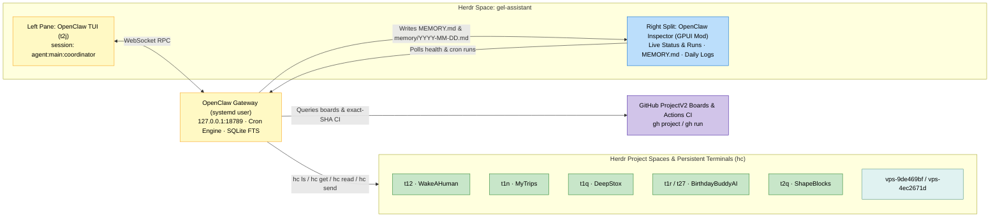

+++
title = "Agentic Workspace"
weight = 2
description = "My agentic development setup: Omarchy, Herdr App, OpenClaw cross-project coordinator, custom GPUI mods, hosted and local models, and a compact keyboard cheat sheet."
updated = 2026-11-18
+++

*Last updated: November 2026*

My workspace brings coding agents into one keyboard-driven workflow. [Agentic Stack](@/generative-ai/1-intro/1_genai_environment.md) covers the tools; this page covers my setup.

## My Setup

| Layer | What I use |
|-------|------------|
| Desktop | **Omarchy / Hyprland** on Linux |
| Agent workspace | **Herdr App** (`herdr-app` + `herdr-core` / `hc`) for persistent `t<ID>` sessions with **Codex CLI, Antigravity (`agy`), Pi**, and remote VPS terminals |
| Cross-project coordinator | **OpenClaw** (`gel-assistant`) driven via its TUI inside Herdr, backed by a localhost-only systemd Gateway (`127.0.0.1:18789`), scheduled automations, and durable FTS memory |
| Custom Herdr GPUI mods | **`assistant-memory` (`OpenClaw Inspector`)** split beside the coordinator TUI for live-reloading `MEMORY.md` / daily logs (`watchFolder`) and real-time Gateway health, cron countdowns, and token telemetry; **`neat-spaces`** and **`review-shortcut`** (`Ctrl+Shift+R`) |
| Mobile access | [**Herdr Mobile**](https://herdr.dev/mobile/) to check agent status and answer agents from my phone over SSH / Tailscale |
| Native apps | **Codex App** and **Antigravity** |
| Hosted models | **Sol 6.1** (Codex / OpenClaw coordinator), **Gemini 4 Argon** (Antigravity), and **DeepSeek V4** through **OpenRouter** |
| Local inference | **Ollama** and **llama.cpp** to reduce API costs; currently **Ornith**, usually liberated, quantized variants |

Herdr organizes sessions, OpenClaw coordinates across projects, the execution harness runs each repo's agent loop, and the model backend provides inference.

## Two-Tier Orchestration: OpenClaw Coordinator + Herdr Workers

Instead of having one overloaded agent touch every repository—or manually tabbing across a dozen terminals to check if tests and deploys passed—my Herdr workspace uses a **two-tier Staff Engineer + Worker pattern**:

1. **Isolated Project Workers (`t<ID>` terminals in `herdr-core`):**
   - Each repository lives in its own Herdr space with persistent Codex or Antigravity workers (`t12`, `t1n`, `t1q`, `t27`, `t2q`, plus remote VPS shells).
   - Every terminal keeps a permanent `t<ID>` address in `herdr-core` (`hc`), even if tabs or spaces are renamed or rearranged, and can be peeked inline from any terminal with `Ctrl + Click`.
2. **The OpenClaw Coordinator (`gel-assistant` space):**
   - Runs in a dedicated `gel-assistant` workspace connected to a hardened, loopback-only background Gateway (`127.0.0.1:18789`, token auth, admin UI/HTTP/mDNS/Tailscale Funnel disabled, `0/75` bundled skills loaded).
   - **Cross-Project Institutional Memory:** Maintains `MEMORY.md`, `BRIEFING.md`, `projects.json`, and dated `memory/YYYY-MM-DD.md` logs indexed with built-in SQLite FTS (`memory_search` / `memory_get`). It remembers architectural constraints, accepted artifacts, and shared VPS dependencies across all projects.
   - **Zero-Noise Scheduled Automations:**
     - **09:00 Weekday Morning Briefing:** Refreshes every item across all five GitHub ProjectV2 boards (including drafts) and live `hc` worker states, then proposes up to three evidence-backed next actions in the TUI.
     - **10:00–18:00 Hourly Progress Checks:** Compares live `hc get` foreground directories, terminal screens (`hc read --lines 0`), and GitHub Actions runs against the last dated observation. If nothing materially changed, it returns `NO_REPLY` and stays completely silent; if a blocker, failure, or review-ready result appears, it surfaces it directly in the coordinator TUI.
   - **Trust-but-Verify Delegation:** When I authorize a task interactively in the TUI, the coordinator dispatches or reviews the repo worker via `hc`, inspects the actual diff and exact-SHA CI/deploy logs independently, catches regressions before accepting a worker's `"done"` status, and updates the GitHub Project board.
3. **Live Native GPUI Split Pane (`OpenClaw Inspector` mod):**
   - Because `herdr-app` renders native GPU panels (`mods`) right alongside terminal panes (`pane.split`), the `OpenClaw coordinator` tab is split with a custom `assistant-memory` mod on the right.
   - Using `watchFolder`, the right pane auto-refreshes `MEMORY.md` and daily `memory/YYYY-MM-DD.md` logs the instant OpenClaw writes to disk, and provides a live **Runtime Status & Runs** view showing Gateway RPC health, event-loop utilization, next cron countdowns, per-run token usage (`in`/`out`/`cache`), and systemd journal entries.

## Pi Packages & Extensions

- **Packages** (`~/.pi/agent/settings.json`): `npm:pi-clear` and [`npm:pi-schedule-prompt`](https://github.com/tintinweb/pi-schedule-prompt).
- **Global extensions** (`~/.pi/agent/extensions/`): `otel-trace.ts` for tracing; `exit.ts` for a clean `/exit`.
- **Traces:** `otel-trace.ts` → OTLP/HTTP at `127.0.0.1:4318/v1/traces` → Doris `otel.otel_traces`. Override the endpoint with `PI_OTEL_ENDPOINT`.

Scheduled prompts require Pi to be running on an awake host.

## Keyboard Basics

These are the Herdr App shortcuts I use to create work, move between sessions, and review changes.

| Action | Shortcut |
|--------|----------|
| New workspace | `Ctrl + Shift + N` |
| New tab | `Ctrl + Shift + T` |
| Previous / next tab | `Alt + [` / `Alt + ]` |
| Previous / next agent | `Alt + ↑` / `Alt + ↓` |
| Previous / next workspace | `Alt + Shift + [` / `Alt + Shift + ]` |
| Focus pane: left / down / up / right | `Alt + h / j / k / l` |
| Split pane down / right | `Ctrl + Shift + E` / `Ctrl + Shift + O` |
| Toggle changes review | `Ctrl + Shift + R` |
| Expand / restore pane | `Ctrl + Shift + Enter` |
| Swap pane left / down / up / right | `Alt + Shift + h / j / k / l` |
| Close focused pane | `Ctrl + Shift + X` |
| Close current tab | `Ctrl + Shift + W` |
| Close current workspace | `Alt + Shift + W` |
| Exit shell (empty input line) | `Ctrl + D` — pane may close when the shell exits |
| Command palette | `Ctrl + Shift + P` |
| Workspace / tab picker | `Ctrl + Shift + K` |
| Rename tab / agent | `F2` |
| Rename workspace | `Shift + F2` |

**How to remember:**

- **E** looks like three horizontal bars: split down, stacking panes.
- **O** sits on the right side of the keyboard: split right.
- **D** = “destroy” as a memory aid: `Ctrl + D` sends end-of-input, usually exiting a shell at an empty prompt.
- **Alt** navigates tabs, agents, and panes. Add **Shift** to `[` / `]` to move up a level to workspaces.
