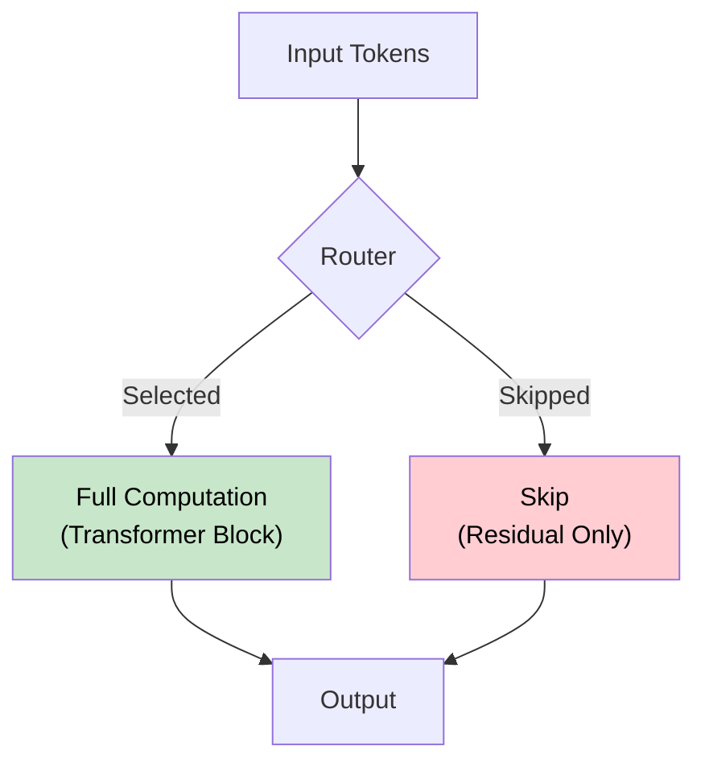
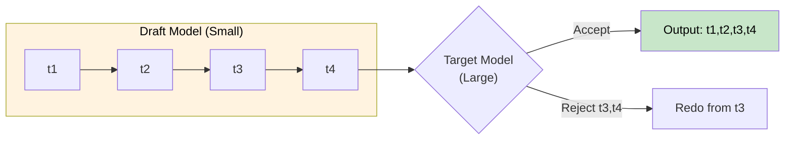
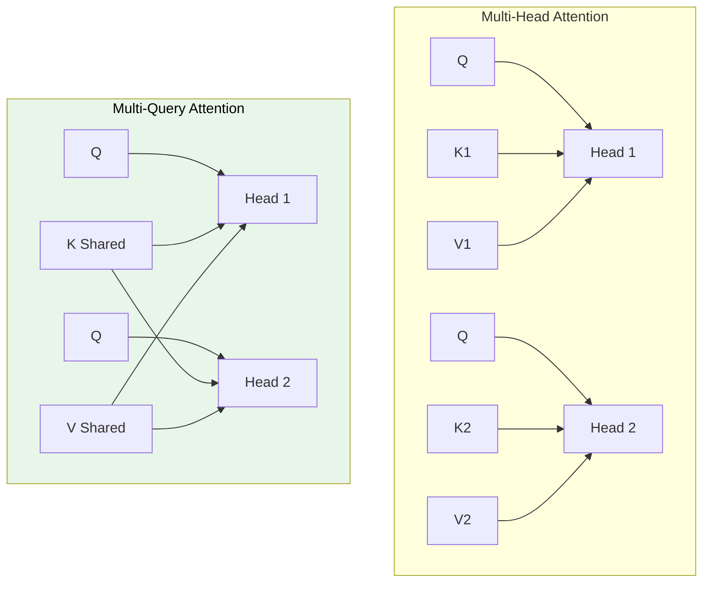
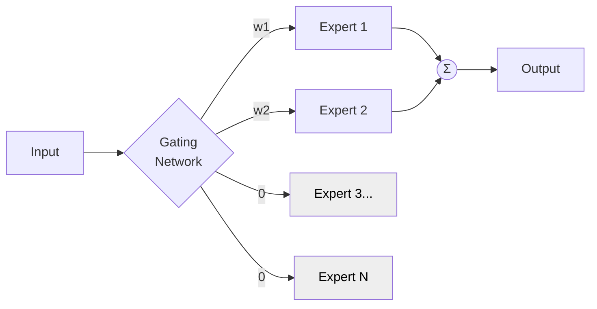

+++
title = "Optimizations"
weight = 3
description = "Research summary of optimizations with practical takeaways for LLMs and production AI systems."
+++

### [Mixture-of-Depths] Dynamically allocating compute in transformer-based LMs

Arxiv: [https://arxiv.org/abs/2404.02258](https://arxiv.org/abs/2404.02258) _2 Apr 2024 **DeepMind**_



The benefit of the approach is the ability to set a compute budget and then based on it enforce limits - for example: enforce how many tokens can participate in block computations. Therefore, in order to avoid performance degradation the challenge becomes how to choose the right tokens for processing.

### [Offload-MoE] Fast Inference of MoE Language Models with Offloading

For the architecture and compute background, read [DeepSeekMoE: shared and routed experts](@/generative-ai/2-genai-research/6_genai_models.md#deepseekmoe-shared-and-routed-experts) and [active parameters and MoE scaling](@/generative-ai/2-genai-research/2_genai_pretraining_finetuning.md#moe-scaling-active-parameters-granularity-and-training-flops).

Arxiv: [https://arxiv.org/abs/2312.17238](https://arxiv.org/abs/2312.17238) _28 Dec 2023 **Yandex**_

We build upon parameter offloading algorithms and propose a novel strategy that accelerates offloading by taking advantage of innate properties of MoE LLM.

Technique 1: LRU Caching
- LRU is a simple strategy that doesn't consider factors like expert activation frequencies
- Keep active experts in GPU memory as a "cache" for future tokens
- If same experts are activated again, they're available instantaneously
- For simplicity, always keep k least recently used experts as cache
- If k > number of active experts, cache saves experts from multiple previous tokens
- Same number of cached experts maintained for each MoE layer

Technique 2: Speculative Loading
- Prefetch next set of experts speculatively while processing previous layer
- Guess likely next experts based on previous layer's hidden states
- If guess is correct, speeds up next layer inference
- If incorrect, can load actual next layer's experts later
- Uses next layer's gating function applied to previous layer's hidden states
- Relies on transformer layers being residual (each layer adds to previous hidden states)

### [LLM-in-a-Flash] Efficient LLM Inference with Limited Memory

Arxiv: [https://arxiv.org/abs/2312.11514](https://arxiv.org/abs/2312.11514) _12 Dec 2023 **Apple**_

Key Techniques:
1. Windowing: Strategically reduces data transfer by reusing previously activated neurons
2. Row-column bundling: Tailored to sequential data access strengths of flash memory, increases size of data chunks read from flash memory

### [RoPE] RoFormer: Enhanced Transformer with Rotary Position Embedding

Arxiv: [https://arxiv.org/abs/2104.09864](https://arxiv.org/abs/2104.09864) _20 Apr 2021 **Zhuiyi Technology Co.**_

#### Why Encode Position?

Token content alone does not explicitly describe order or distance. A causal mask controls which tokens can attend to which earlier tokens; positional encoding supplies an explicit position signal. Absolute embeddings add a position vector to the token representation. RoPE instead rotates coordinate pairs in **queries and keys** before their dot product. Standard RoPE leaves values unchanged. [RoFormer, Sections 2–3](https://arxiv.org/html/2104.09864v5#S3).

#### Angles, Frequencies, and the Base

For rotary dimension **d**, pair index **i = 0, …, d/2 − 1**, and token position **p**:

**ω_i = B^(−2i/d)** and **φ_i(p) = p × ω_i**

The original frequency base is **B = 10,000**. Each pair rotates at its own rate, like clocks with different speeds. A pair **(u, v)** becomes:

```text
u′ = u cos φ − v sin φ
v′ = u sin φ + v cos φ
```

Equivalently, define **β_base = B^(2/d)**; then **ω_i = β_base^(−i)**. This algebraic rewrite explains the base-β notation used in some discussions. Keep it distinct from YaRN's β threshold below.

**Worked illustration:** with d = 8 and B = 10,000, β_base = 10:

| Coordinate pair | Frequency ω_i | Angle at p = 10, in radians |
|-----------------|---------------|----------------------------|
| 0 | 1 | 10 |
| 1 | 0.1 | 1 |
| 2 | 0.01 | 0.1 |
| 3 | 0.001 | 0.01 |

#### Why Relative Distance Appears

Writing the block of pairwise rotations at position m as **R(m)**:

**(R(m)q)ᵀ(R(n)k) = qᵀR(n − m)k**

The positional contribution depends on **n − m**; content still determines the score. [RoFormer, Section 3.2](https://arxiv.org/html/2104.09864v5#S3.SS2).

For fixed, unrotated q and k, positions **3 and 7** and positions **13 and 17** produce the same relative rotation: both have separation 4. This does not mean whole sequences shifted by ten tokens have identical hidden states.

RoPE can calculate angles beyond the training window. Reliable behavior there requires more than a defined formula; this motivates [Position Interpolation](#position-interpolation-extending-context-windows) and [YaRN](#yarn-context-extension-with-ntk-aware-scaling).

### [Position Interpolation] Extending Context Windows

Paper: [Extending Context Window of Large Language Models via Position Interpolation](https://arxiv.org/abs/2306.15595) — Chen et al., June 2023, **Meta**.

#### Fit More Positions into the Trained Range

Direct extrapolation feeds a model positions beyond its training window. Position Interpolation (PI) instead compresses the coordinates. For original window **L**, target window **L′**, and extension factor **s = L′/L**:

**p′ = p/s**, so **φ_i(p) = (p/s) × ω_i**

Equivalently, keep p and replace every frequency with **ω_i/s**. The paper combines this change with fine-tuning to adapt pretrained RoPE models to longer context. [Method, Section 2](https://arxiv.org/html/2306.15595v2#S2).

**Worked illustration:** extend 4,096 positions to 16,384, so s = 4:

| Actual token position p | RoPE coordinate p′ |
|-------------------------|--------------------|
| 0 | 0 |
| 4,096 | 1,024 |
| 8,192 | 2,048 |
| 16,383 | 4,095.75 |

The model still processes **16,384 tokens**. Only the position coordinates are compressed; tokens are not merged or removed.

Uniform compression also reduces the angular separation of neighboring positions at every frequency. Preserving local positional detail while extending the range motivates the frequency-dependent methods in [YaRN](#yarn-context-extension-with-ntk-aware-scaling).

### [YaRN] Context Extension with NTK-aware Scaling

Paper: [YaRN: Efficient Context Window Extension of Large Language Models](https://arxiv.org/abs/2309.00071) — Peng et al., first released August 2023. The equations below follow the [November 2023 version, Section 3](https://arxiv.org/html/2309.00071v2#S3).

#### NTK-aware: Change the Frequency Base

**NTK** refers to the **Neural Tangent Kernel**. NTK-aware scaling changes RoPE's base instead of scaling all frequencies equally. For rotary dimension **d > 2**:

**B′ = B × s^(d/(d − 2))**, then **ω′_i = B′^(−2i/d)**

The fastest pair stays unchanged; progressively slower pairs are stretched more. This differs from PI's uniform scaling. See [Section 3.1](https://arxiv.org/html/2309.00071v2#S3.SS1) and the [authors' NTK-aware implementation](https://github.com/jquesnelle/yarn/blob/master/scaled_rope/LlamaNTKScaledRotaryEmbedding.py).

#### NTK-by-parts: Choose Which Bands to Stretch

Let **λ_i = 2π/ω_i** be one full rotation's length in tokens, and **r_i = L/λ_i** the rotations within the original window. Thresholds **α** and **β** define the bands:

| Band | Treatment |
|------|-----------|
| Slow: r_i < α | Interpolate fully: ω′_i = ω_i/s |
| Middle: α ≤ r_i ≤ β | Blend interpolated and original frequencies |
| Fast: r_i > β | Preserve original frequency: ω′_i = ω_i |

The paper uses **α = 1, β = 32** for its LLaMA experiments. Here β is a band cutoff, distinct from **B**, **β_base**, and rotation angle **φ**. [Section 3.2](https://arxiv.org/html/2309.00071v2#S3.SS2).

The [authors' implementation](https://github.com/jquesnelle/yarn/blob/master/scaled_rope/LlamaYaRNScaledRotaryEmbedding.py) names these cutoffs `beta_slow` and `beta_fast`, respectively.

#### YaRN Adds Attention Scaling

YaRN combines NTK-by-parts with a temperature **t** applied before attention softmax:

**softmax(q′ᵀk′ / (t × √d))**

Temperature changes attention sharpness; it is separate from the frequency adjustments. [Section 3.4](https://arxiv.org/html/2309.00071v2#S3.SS4).

#### What Context Extension Does Not Guarantee

**Dynamic NTK** adjusts scaling with the current sequence length; it is a related variant, not another name for YaRN. Context-extension quality depends on adaptation and evaluation. [Section 3.3](https://arxiv.org/html/2309.00071v2#S3.SS3).

Accepting a longer input and using distant information reliably are separate tests. Position scaling also does not remove the cost of processing the extra tokens: dense attention's pairwise work grows quadratically with sequence length, and the KV cache grows with stored tokens. The existing [GQA](#gqa-training-generalized-multi-query-transformer-models-from-multi-head-checkpoints) and [multi-query attention](#multi-heads-sharing-fast-transformer-decoding-one-write-head-is-all-you-need) notes address KV-cache costs.

### [Speculative] Fast Inference from Transformers via Speculative Decoding

Arxiv: [https://arxiv.org/abs/2211.17192](https://arxiv.org/abs/2211.17192) _30 Nov 2022 **Google**_



Key Observations:
- Some inference steps are "harder" and some are "easier"
- Inference from large models is often bottlenecked on memory bandwidth and communication
- Additional computation resources might be available

Solution:
- Increase concurrency as complementary approach to adaptive computation
- Accelerate inference without:
  - Changing model architectures
  - Modifying training procedures
  - Re-training models
  - Changing model output distribution
- Accomplished via speculative execution

### [GQA] Training Generalized Multi-Query Transformer Models from Multi-Head Checkpoints

Arxiv: [https://arxiv.org/abs/2305.13245](https://arxiv.org/abs/2305.13245) _22 May 2023 **Google**_

### [Multi-Heads Sharing] Fast Transformer Decoding: One Write-Head is All You Need

Arxiv: [https://arxiv.org/abs/1911.02150](https://arxiv.org/abs/1911.02150) _6 Nov 2019 **Google**_



Multi-head attention layers are a powerful alternative to RNNs for moving information across and between sequences. While training is generally fast and simple due to parallelizability, incremental inference is often slow due to memory-bandwidth costs of loading large "keys" and "values" tensors.

Solution: Multi-query attention
- Keys and values are shared across all attention "heads"
- Greatly reduces size of tensors and memory bandwidth requirements
- Much faster to decode with minor quality degradation
- Identical to multi-head attention except heads share single set of keys and values

### [MoE] Outrageously Large NN: The Sparsely-Gated MoE Layer

For a transformer architecture using shared and routed experts, continue to [DeepSeekMoE](@/generative-ai/2-genai-research/6_genai_models.md#deepseekmoe-shared-and-routed-experts), then [active parameters and training FLOPs](@/generative-ai/2-genai-research/2_genai_pretraining_finetuning.md#moe-scaling-active-parameters-granularity-and-training-flops).

Arxiv: [https://arxiv.org/abs/1701.06538](https://arxiv.org/abs/1701.06538) _23 Jan 2017 **Google**_



Key Points:
- Neural network capacity is limited by number of parameters
- Conditional computation (parts active per-example) proposed to increase capacity
- Introduces Sparsely-Gated Mixture-of-Experts layer (MoE)
- Consists of up to thousands of feed-forward sub-networks
- Trainable gating network determines sparse combination of experts per example
- Applied convolutionally between stacked LSTM layers
- Achieves better results than state-of-the-art at lower computational cost

### [MoE] MoE Meets Instruction Tuning: A Winning Combination for LLM

Arxiv: [https://arxiv.org/abs/2305.14705](https://arxiv.org/abs/2305.14705) _24 May 2023 **Google**_

Sparse Mixture-of-Experts (MoE) is a neural architecture design that can be utilized to add learnable parameters to Large Language Models (LLMs) without increasing inference cost.
